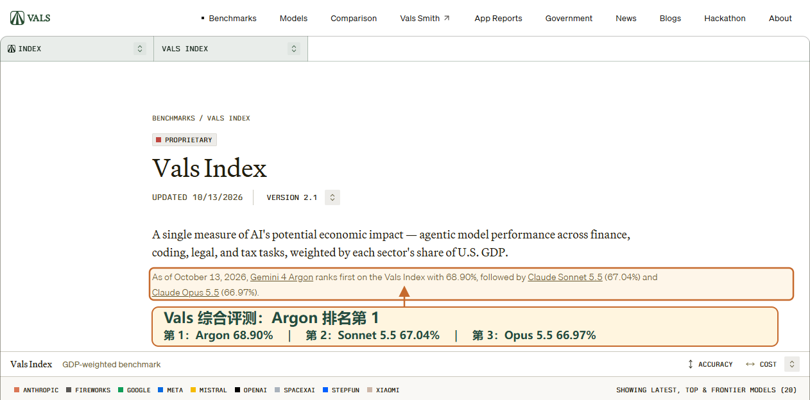
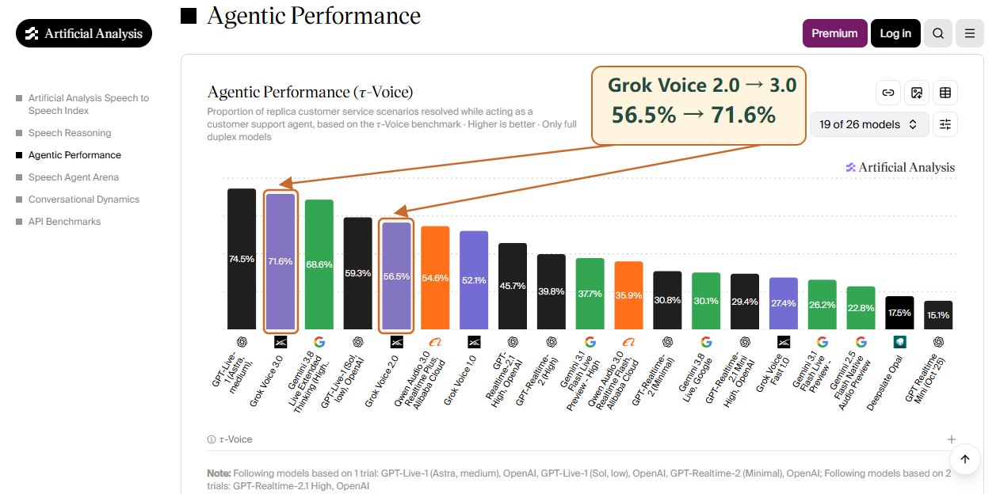

# AI日报：三条精简口播与两张标注示例

以下为用户于2026-11-01确认的历史表达示例，仅学习信息取舍、条件衔接和素材标注，不作为当期新闻事实、数据来源或历史播出清单，无需逐期重查。其中的产品、日期、版本及排名不能直接沿用。

三条均为产品类写法，行业资讯按事件重点另行组织，不必套用使用入口或版本条件。保留横向排名、版本前后对比两张标注图；WorkBuddy示例只有口播。

## 1. Gemini：入口、会员条件与评测

Gemini 4 Argon 扩大开放。Pro 和 Ultra 会员可在 Gemini 聊天应用和谷歌搜索的 AI 问答中使用；独立编程工具 Antigravity 则需 Ultra。Mac 版 Gemini 也接入了编程界面，聊天和写代码可在应用内切换。在涵盖金融、编程、法律和税务任务的 Vals 综合评测中，Argon 以百分之六十八点九排名第一。

素材重点：突出排名与比较对象，分数作辅助；不把综合指标外推为所有能力。

## 2. Grok：同指标前后对比

Grok Voice 3.0 已向开发者开放。在含口音、噪声和中途打断的模拟客服评测中，Artificial Analysis 测得的任务完成率，从上代的百分之五十六点五升至百分之七十一点六。

素材重点：保留同一τ-Voice指标、两代型号与前后数值，突出变化；引导线不交叉。学习标注关系，不照搬网页里的全部导航和小字。

## 3. WorkBuddy：新增入口与使用条件

企业微信与 WorkBuddy 深度互通：可在企微通讯录中找到 WorkBuddy 机器人，WorkBuddy 也支持企微账号登录，由企业统一管理账号、用量和权限。企微和 WorkBuddy 的最低版本分别是 5.0.12 和 5.8.0。限免体验面向已认证企业，企业开通后，用户需取得使用席位。

表达重点：把新增入口与企业身份、最低版本和席位条件接在一起讲，不用原有通用任务场景充当更新亮点。
