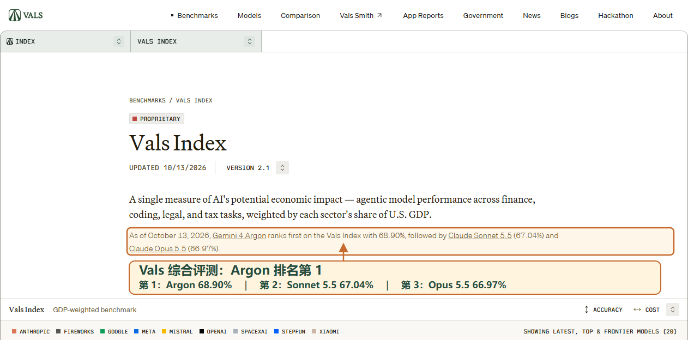
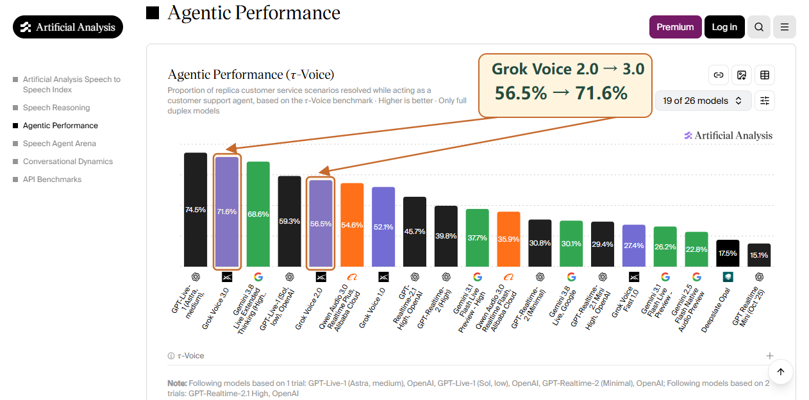
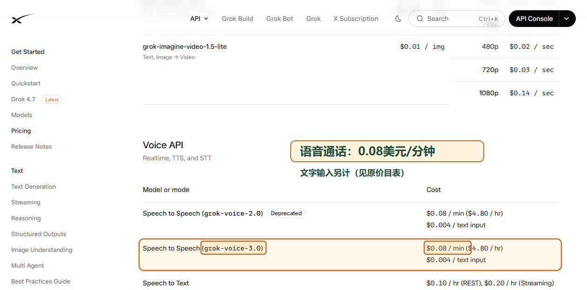

# AI日报：三条口播与素材示例

固定本地参考。用于学习表达、信息取舍和素材标注，不作为新一期新闻事实或数据来源；无需逐期重查这些历史案例，也不据此锁定后续镜头、布局和动画。

共三条口播、三张现有标注图：横向排名、版本前后对比、官方价格。WorkBuddy示例重点展示如何集中交代新增入口与使用条件。

## 1. Gemini：把使用入口和会员条件放在一起讲

Gemini 4 Argon 正式扩大开放范围。Pro 和 Ultra 会员，现在都能在 Gemini 聊天应用，以及谷歌搜索的 AI 问答功能中使用这个模型。如果是在谷歌的独立编程工具 Antigravity 中使用，则需要 Ultra 会员。

这次更新还把 Antigravity 的编程界面接入了 Mac 版 Gemini，让聊天和写代码可以在同一个应用里切换。性能方面，在涵盖金融、编程、法律和税务任务的 Vals 综合评测中，Argon 以百分之六十八点九排在首位。

素材重点：突出“Vals综合评测排名第1”，以第二、第三名为参照，分数作辅助依据。

## 2. Grok：用同口径前后对比说明升级

Grok Voice 升级到 3.0。在处理带口音、背景噪声和中途打断的模拟客服任务时，评测机构 Artificial Analysis 给出的成绩，从上代的百分之五十六点五升到了百分之七十一点六。新版已向开发者开放，语音通话单价仍是每分钟八美分。

素材重点：同时标出2.0与3.0的型号和分数，引导线互不交叉，保留τ-Voice指标。

口播提到单价时，使用官方价格表，框出型号及分钟单价，并保留文字输入另计的条件。

## 3. WorkBuddy：聚焦此次增量与可用条件

企业微信和 WorkBuddy 发布了深度互通版本。这次更新，WorkBuddy 以机器人身份进入企微通讯录，WorkBuddy 客户端也支持直接用企业微信账号登录，企业可以统一管理账号、用量和权限。使用前要把企微更新到 5.0.12 及以上，WorkBuddy 更新到 5.8.0 及以上。目前面向已认证企业开放限免体验名额，需要企业开通，并取得使用席位。

这条示范新增入口、企业身份、版本和席位如何串在一起讲，不用原有通用任务场景充当本次更新。
